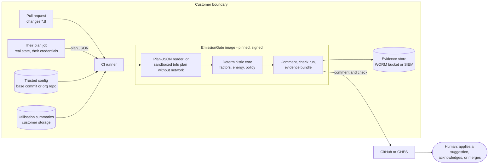
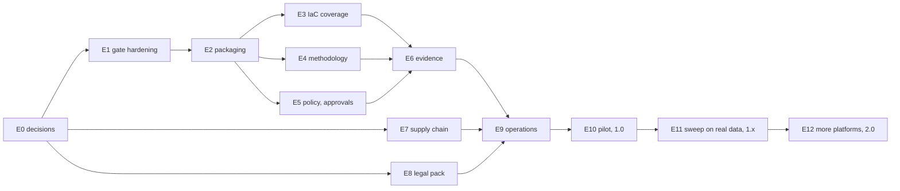

# Enterprise readiness plan

This plan takes EmissionGate from a hackathon tool to a plugin that any organisation can run on its own
repositories. It is the checklist for that work, with how to do each part. It follows the conventions of
[BUILD_PLAN.md](BUILD_PLAN.md): work top to bottom, tick a box in the commit that completes it, and close
a phase only when its **Done when** criteria are shown with a command or test output.

> Status: proposed, 11 Oct 2026; work started 25 Oct 2026 (see [Progress](#progress)). Decisions in
> E0 are recommendations until their ADRs are accepted. Targets marked *proposed* are starting values
> to confirm in E0.

## Starting point

**Keep.** These are the product's value and its safety case:

- The deterministic core: every published number comes from `core/`, with provenance and golden tests
  (ADR-0001).
- No capability to change infrastructure; the OpenTofu wrapper is plan-only (ADR-0003).
- Fail-closed guardrails in `policy.yaml`, advisory-only kinds and hard budgets.
- The append-only ledger of every tool and LLM call.
- A gate with no LLM, and a sweep whose LLM only chooses among allowed options.
- `make demo-offline score` on the synthetic estate. Keep it as the regression suite.

**Gaps between the hackathon build and production** (from reading the code on 11 Oct 2026):

| Area | Today | Needed |
|---|---|---|
| Data | billing, metrics and prices must be labelled synthetic (`tools/metrics.py`, `agents/collector.py`, `core/interventions.py`); the telemetry window is hard-coded (`orchestrator/machine.py`) | real billing and utilisation from the customer's own stores, with data origin in provenance (E11) |
| Packaging | factors, policy and `tofu/versions.tf` are found relative to the repo root (`config.py`, editable install); the wheel ships only prompts and templates | a self-contained wheel, a signed image and a GitHub Action (E2) |
| Coverage | 18 instance types vendored; the gate reads root-module resources only (`agents/diff_collector.py`) | full factor extraction, modules, monorepos and more resource types (E3, E4) |
| Untrusted input | the gate plans pull-request code after a regex-based screen | parser-based screening, sandboxing and trusted configuration (E1) |
| Delivery | live PRs, `sync-feedback`, calibration, `--resume` and the bake-off are designed, not built | built and tested (E11) |
| Repository hygiene | no `LICENSE`, `NOTICE`, `SECURITY.md`, `CONTRIBUTING.md`, `CODEOWNERS` or Dependabot config; workflow actions pinned by tag | E7, E8 |
| SCM | GitHub.com only (the API URL is a constant in `tools/github.py`); results are a comment plus the job's exit code | GHES and check runs (E2); other SCMs later (E12) |

## What "plugin" means here

| Surface | What the organisation installs | Runs where | Phase |
|---|---|---|---|
| CLI (PyPI) and container image | `pip install emissiongate`, or the signed image | their runners | E2 |
| GitHub Action and reusable workflows | one workflow file, pinned to a release SHA | their GitHub runners, hosted or self-hosted | E2 |
| Plan-JSON mode | one step after the plan job they already run (Actions, Atlantis, Spacelift, env0, Terramate, TFC agents) | their pipeline | E2 |
| pre-commit hook | a local check before push | developer machines | E2 |
| GitLab, Azure DevOps, Bitbucket, Jenkins | a CI component, extension, pipe or shared library | their CI | E12 |
| Self-hosted GitHub App | an org-wide install with central policy and check runs | their infrastructure | E12, optional |
| Vendor-hosted service | — | a vendor's cloud | not in v1 |

**Recommendation.** v1 is customer-run only: there is no EmissionGate server, so customer code, plans,
billing and telemetry never leave the customer's boundary. That keeps the compliance scope small: no
service certification and no hosting DPA. GitHub comes first.

**Plan-JSON mode is the default for real repositories.** The customer's pipeline already plans with
real state, modules, data sources and its own credentials. EmissionGate parses that plan's JSON and never
executes the pull request's code. Sandboxed planning stays available for repositories without a plan job.

## Target architecture (v1)

## Release train

| Release | Adds | Audience |
|---|---|---|
| 0.2 | E0 and E1: decisions, threat model, hardened gate | maintainers only |
| 0.5 | E2: wheel, signed image, GitHub Action, plan-JSON mode | design partners, as a non-blocking check |
| 1.0 | E3–E10: coverage, reviewed methodology, policy hierarchy, evidence, supply chain, legal pack, operations, pilot | any organisation; may be a required check |
| 1.x | E11: the sweep on real data, with live fix PRs | organisations that opt in per repository |
| 2.0 | E12: GitLab, Azure DevOps, Bitbucket and Jenkins; optional GitHub App | — |

## Order of work

E7 and E8 can start on day one alongside E1; neither changes product code.

## How to work through this plan

- Each phase is an `E<n>` milestone, run with the same loop as `/milestone`: write a plan, write tests
  first for `core/`, implement, prove each **Done when**, run the invariant review, write an ADR for any
  changed decision, and make small commits that say why.
- E1 is security work on a public repository that invites others to copy its workflow. Develop it in a
  private fork or a draft GitHub security advisory, release the fix, then publish the notes.
- Human-run steps stay with a human, as `AGENTS.md` already requires: anything needing network, cloud
  accounts, GitHub App creation, signing keys or legal sign-off.

**First steps, this week:** E0 ownership and ADR-0018; add `LICENSE`, `SECURITY.md` and `CODEOWNERS`
(E7, E8); mark the docs "demo, not for production use" (E0); start the threat model and trusted
configuration (E1); add read-only default `permissions` and pin actions by SHA (E7).

## Progress

Boxes are ticked only when an item is complete. Partial work is listed here.

**25 Oct 2026 — E0, E1 (first controls), E7/E8 day-one items.**

| Phase | Done | Partial or waiting |
|---|---|---|
| E0 | demo warnings in README and USING_THE_GATE; `milestone` skill accepts `E<n>` | ADR-0018 to ADR-0021 written as **proposed** (delivery shape, telemetry path, invariant wording, support matrix, compatibility and targets) — waiting for acceptance before `AGENTS.md` invariants change; ownership and IP, steward, GHES version and the hackathon-material move need a human decision |
| E1 | trusted configuration (`--ci`, `--config-from-base`); tree export from git objects; acknowledgement bound to the head SHA with a permission check; escaped output; coverage in every comment; `tests/security/` | threat model written, not yet reviewed; screen is an interim regex hardening (all directories, unscreenable formats refused, file reads confined) until the parser lands; reference workflow re-laid out with `--ci` but actions not yet pinned by SHA and no fork pattern; team-membership checks and sandboxed planning not started; the gate process still holds `GITHUB_TOKEN` while tofu plans as its child (screen blocks the known read paths; the two-job split or sandbox is the structural fix — THREAT_MODEL residual risks) |
| E7 | read-only default `permissions` in `ci.yml`; `CODEOWNERS`; Dependabot for pip and Actions | pin actions by SHA (needs a network lookup by a human); `SECURITY.md` written — a human must enable private vulnerability reporting in the repository settings |
| E8 | `LICENSE` (Apache-2.0 text) and `NOTICE` | copyright holder in `NOTICE` is "The EmissionGate authors" until ownership is confirmed (E0) |

Behaviour changes in E1: a PR whose plan has resource changes but none carbon-relevant now gets a comment
stating coverage (before, no comment); an acknowledgement is the label plus a pull-request review on the
head commit by someone with write access (before, the label plus a comment, matched by time).

---

## E0 — Decisions and ground rules  `[ ]`

- [ ] **Ownership and IP.** Confirm the code may be published and maintained under Apache-2.0. Check the
  hackathon terms and any employer IP or open-source policy (the demo video is on a corporate
  SharePoint). Decide the steward: an individual, a company, or a foundation such as the Green Software
  Foundation. Record the steward in `GOVERNANCE.md`.
- [ ] **Delivery shape.** Accept or change the recommendation above in ADR-0018, *Customer-run plugin:
  CLI, image, GitHub Action and plan-JSON mode; no hosted service in v1*. It amends ADR-0009 and ADR-0015.
- [ ] **Invariants for real data.** The invariants in `AGENTS.md` assume synthetic data and a laptop.
  Write the ADRs first, then update `AGENTS.md`:
  - Invariant 12 (*all data is synthetic*) becomes: customer data stays in the customer's boundary; demo
    and test data are synthetic and labelled; every figure records its data origin
    (`synthetic` | `customer`).
  - Invariant 3 (*no capability to change infrastructure*) stays as it is. ADR-0019 decides how telemetry
    is read. Either the customer stages exports and EmissionGate reads files (recommended for v1), or a
    read-only reader uses an allowlist of API actions and ships a read-only IAM policy.
  - Invariant 10 (*offline*) becomes: the gate runs with network egress blocked except to the declared
    SCM API. The offline demo is unchanged.
  - Invariant 13 (*secrets*) becomes: short-lived credentials only — the Actions token, OIDC federation
    and GitHub App installation tokens.
  - Invariant 14 (*the gate informs*) gains the approval rules from E5.
- [ ] **Support matrix v1.** GitHub.com and GHES (choose the oldest GHES version to support), Linux amd64
  and arm64 runners, OpenTofu ≥ 1.8 and Terraform plan JSON as input, AWS first.
- [ ] **Compatibility contract.** Semantic versioning covers CLI flags, config and policy schemas, exit
  codes, the comment marker, the check-run name, the ledger and evidence schemas and `GatePrediction`.
  Removals follow one minor release of deprecation warnings.
- [ ] **Targets.** Confirm or change the proposed targets used below: coverage, latency, Scorecard score,
  vulnerability fix times and the test coverage floor.
- [ ] **Hackathon material.** Move the pitch deck, demo script and augmentation log under
  `docs/hackathon/`, leaving git history as it is. Decide whether the augmentation log continues.
- [x] **Expectations.** Until 1.0, mark the README and `USING_THE_GATE.md` "demo, not for production use".
- [x] **Agent workflow.** Let the `milestone` skill accept `E<n>` from this file. Edit the canonical
  `.agents/skills/milestone/SKILL.md`, then run `make agent-check`.

**Done when:** ADR-0018, ADR-0019 and the invariant ADRs are accepted, `AGENTS.md` is updated, and
`make agent-check` passes within the 24 KiB budget.

## E1 — Gate hardening for untrusted pull requests  `[ ]`

The gate reads code from pull requests. An organisation must be able to run it on every PR and make its
check required. Follow GitHub's security hardening guidance for Actions; the items below are the
minimum controls.

- [ ] **Threat model.** Write `docs/THREAT_MODEL.md`:
  - Assets: integrity of the check result, tokens, the runner, customer telemetry, evidence.
  - Actors: PR author, fork contributor, reviewer, maintainer, a compromised dependency.
  - Trust boundaries: the PR tree, the engine, OpenTofu, the SCM API, data stores.
  - STRIDE per boundary, with the control for each threat. Review it at every release.
- [x] **Trusted configuration.** These come only from trusted sources — action inputs, the base commit,
  or an organisation config repository — never from the pull request's working tree: policy,
  suppressions, factors, prices, telemetry summaries and tool paths.
  - In CI mode there is no `.env` loading, and binaries come from the image only.
  - How: `load_settings(trusted_root=…, ci=True)`; read base-branch files with
    `git show <base_sha>:<path>`.
  - Test: editing any of these inside a PR does not change the result.
- [x] **Faithful tree export.** Materialise the base and head trees from the commit objects alone
  (`git ls-tree -r -z` with `git cat-file --batch`). Check that the exported file list equals the
  commit's tree.
- [x] **Acknowledgement bound to the head commit.** Decide acceptance from server-side records tied to
  the head SHA, such as a pull-request review whose `commit_id` equals the head SHA. Check the
  acknowledger's permission (`GET /repos/{o}/{r}/collaborators/{user}/permission`) or team membership.
- [ ] **Parser-based screen.** Replace the regex screen in `core/safety.py` with a parser-based
  allowlist.
  - It covers every file OpenTofu loads: `.tf`, `.tf.json`, `.tofu`, `.tofu.json`, variable files, and
    local modules recursively.
  - By default, it denies anything that reads outside the configuration or can reach a network at plan
    time.
  - A refusal stays "not evaluated", a neutral result.
  - Check the parser's licence.
- [ ] **Sandboxed planning.** Defence in depth for sandbox mode. OpenTofu runs:
  - with no network, as an unprivileged user, on read-only inputs;
  - with its working and data directories outside the checkout;
  - with an environment allowlist instead of a denylist;
  - with a provider configuration that EmissionGate generates for offline use.
- [x] **Untrusted text in output.** Escape addresses, attribute values, tool errors and reasons for
  Markdown and HTML; cap their length; neutralise mentions and links. Validate attribute values against
  their expected formats before display.
- [ ] **Reference workflow.**
  - Per-job `permissions`: `contents: read`, plus `pull-requests: write` or `checks: write` only where
    needed.
  - Actions pinned by full SHA; the engine pinned by version and image digest.
  - No `pull_request_target` job that checks out PR code.
  - Fork PRs use the two-workflow pattern; the privileged job only reads a schema-validated JSON
    artefact.
  - Runner egress restricted.
- [x] **Visible coverage.** Every comment states how many changed resources were seen, quantified and
  not quantified, with reasons. A PR gets no comment only when its plan has no resource changes at all.
- [ ] **Security regression suite.** `tests/security/` holds one test per control and runs in CI.
- [ ] **Independent review.** Before 1.0, someone outside the build (external if possible) reviews the
  gate's security. P0 and P1 findings are fixed.

**Done when:** the threat model is reviewed; every control has a passing test; the reference workflow
passes `zizmor` and `actionlint` with no high findings; the review has no open P0 or P1.

## E2 — Packaging and distribution (the plugin)  `[ ]`

- [ ] **Self-contained wheel.** Move factors, the default policy, `tofu/versions.tf` and fixtures into the
  package (`src/emissiongate/data/`, read with `importlib.resources`). Keep the provenance of `factors/`
  and its "never edit by hand" rule. Test: install the wheel in a clean venv and run `gate` and the
  offline demo from an empty directory.
- [ ] **Locked dependencies.** Use `uv lock`, or pip-tools with hashes. CI and the image install from the
  lock. Test on Python 3.12 and 3.13.
- [ ] **Container image.**
  - Multi-stage build; OpenTofu pinned and checksum-verified.
  - Provider mirror baked in, with lock hashes for amd64 and arm64.
  - Runs as non-root and works with a read-only root filesystem; minimal base image (check its licence).
  - SBOM and provenance attached; signed with cosign.
- [ ] **GitHub Action.** `action.yml` runs the image by digest, writes a job summary, has its own release
  tags and a Marketplace listing.
  - Inputs: `mode` (`plan-json` | `sandbox-plan`), plan paths, `policy-source`, `telemetry-source`,
    `report` (`comment`, `check-run` or both).
  - Outputs: `status`, `net_kg_co2e_yr`, `coverage`, `evidence-path`.
- [ ] **Check run.** A named check, `EmissionGate / carbon`, with a summary and annotations on changed
  lines, so branch protection can require it. Keep exit codes for other CIs.
- [ ] **Plan-JSON mode.**
  - `emissiongate gate --plan-json plan.json` reads one plan made against real state, with before and
    after from `resource_changes`.
  - `--base-plan` and `--head-plan` compare two configurations.
  - Validate `format_version` and enforce size limits.
  - Write recipes for Actions with an existing plan job, Atlantis, Spacelift, env0, Terramate and TFC
    agents.
- [ ] **Consumer configuration.** `.emissiongate/config.yml` is versioned, validated against a JSON
  Schema, and read from the base commit. Organisation defaults come from a central repository.
  `emissiongate config validate` checks it.
- [ ] **SCM adapter.** A `tools/scm/` protocol (comment upsert, check result, labels, reviews,
  permissions), with GitHub as the first implementation. The API base URL is configurable for GHES, and
  pagination has no 10-page cap.
- [ ] **Local use.** A pre-commit hook, and `emissiongate gate --local` before push.
- [ ] **Release pipeline.**
  - Semantic versioning, a changelog (release-please or similar) and signed tags.
  - Each release ships: wheel, sdist, image, action tag, SBOM and provenance.
  - Verification steps documented.

**Done when:** a new repository adopts the gate with one workflow file pinned to a release; a clean
machine installs from PyPI; the image signature and provenance verify; plan-JSON mode is tested on
OpenTofu and Terraform plans.

## E3 — Real-world Terraform and OpenTofu coverage  `[ ]`

- [ ] **Modules.** Read `resource_changes`, recurse into `child_modules`, and show module addresses.
- [ ] **Monorepos.** Find the root modules a PR changes: directories with `terraform`, backend or
  provider blocks, or a project list like Atlantis's. Evaluate each one. Post one comment with a section
  per project and a PR total.
- [ ] **Variables and workspaces.** Resolve region references from the plan's `variables`; support var
  files per project, and workspaces.
- [ ] **Region.** Use the resource-level region from the plan, then the provider configuration, else
  "not quantified". Never a default.
- [ ] **Resource types.** Add them roughly in order of typical energy use:
  - compute: EC2 (launch templates in modules, mixed-instances policies), EKS managed node groups, ECS
    on EC2 and Fargate, Lambda;
  - data and ML: RDS and Aurora, ElastiCache, OpenSearch, Redshift, SageMaker endpoints;
  - storage: EBS, S3.

  Each type needs a contract, a METHODOLOGY section, a golden test and factor provenance. Use the
  `add-intervention` skill for new templates.
- [ ] **HCL editing.** `core/hcl.py` edits the estate's known shape. Suggestions and sweep fixes on real
  code need an editor that preserves formatting. Evaluate tree-sitter-hcl and hcledit, check licences,
  and record the choice in an ADR. Templates only, never free-form HCL (ADR-0005).
- [ ] **Corpus.** Build a test corpus from public Apache-2.0 or MIT module examples (for example
  terraform-aws-modules; check each licence), plus plan JSON fixtures from several OpenTofu and Terraform
  versions.

**Done when:** on the corpus, the quantified share of changed EC2, ASG, RDS and EBS resources meets the
E0 target (*proposed* 90%); a PR touching three projects in a monorepo gets one comment with three
sections.

## E4 — Methodology, factors and the numbers organisations will quote  `[ ]`

- [ ] **Reproducible extraction.** `factors/README.md` says the factors were extracted by script, but the
  script is not in the repository. Commit it.
  - Pin the upstream commit and record checksums.
  - Extract every instance type and region. Today there are 18 instance types, enough for the synthetic
    estate only.
- [ ] **Update process.** A scheduled job opens a PR when upstream changes. Each upstream version gets a
  new file, an ADR, a golden re-run and a methodology-auditor review. Every figure keeps its version
  (already built).
- [ ] **Grid intensity.** Review how current the annual regional factors are. Evaluate sources with
  provenance and licence checks: Ember annual data, provider-published figures, or a customer's own
  Electricity Maps or WattTime licence. Tiers stay labelled.
- [ ] **Scope statement.** Write down what is in scope:
  - Location-based operational emissions of cloud usage (the customer's Scope 3, category 1).
  - Market-based figures only if the customer supplies contractual instruments.
  - Embodied emissions optional and labelled (CCF publishes embodied coefficients).
  - Networking: state whether it is in or out.
- [ ] **Uncertainty.** Keep ranges for assumed load. Add documented uncertainty for observed figures
  (coefficient minimum and maximum). Never show a point estimate as exact.
- [ ] **Calibration (M10).** Compare predicted with observed after deploy, and report the error by basis
  in the evidence export.
- [ ] **Reconciliation.** Compare monthly totals with the provider's own carbon reports (AWS Customer
  Carbon Footprint Tool, Azure Emissions Impact Dashboard, Google Cloud Carbon Footprint). Explain
  differences; never force agreement.
- [ ] **Cost.** Replace synthetic prices with the customer's billing (effective cost) or public
  price-list files, and label the source.
- [ ] **Review.** A carbon-accounting practitioner reviews the methodology. Its version appears in every
  comment and evidence bundle.

**Done when:** the factors cover the E0 target share of instance types in the corpus (*proposed* 95%); the
methodology review is published; every comment shows the methodology version, factor version, tier,
data origin and uncertainty.

## E5 — Policy-as-code and human-approval guardrails  `[ ]`

- [ ] **Policy schema.** A pydantic model and a published JSON Schema for policy, suppressions and
  config, each with a `version`.
  - Unknown keys or wrong types fail closed. Today `core/policy.py` checks that required keys exist, not
    their types.
  - `emissiongate policy validate`, and `policy test` (fixtures in, expected verdicts out).
- [ ] **Hierarchy.** Policy resolves organisation, then repository, then path.
  - A repository can only make guardrails stricter: protected tags, required tags, advisory-only kinds.
  - Thresholds can move only within organisation bounds.
  - Policy files are owned by CODEOWNERS.
- [ ] **Who can accept an increase.**
  - Named teams or CODEOWNERS.
  - Separation of duties: the acknowledger is not the PR author. On by default for production
    environments.
  - A minimum reason length, an optional ticket pattern, and per-environment thresholds.
  - One acknowledgement per head SHA (E1).
- [ ] **Break-glass.** A restricted override for incidents. It is always recorded and listed in the
  evidence export.
- [ ] **Error semantics.** `on_error: neutral | fail` and `min_coverage`, set per organisation. The
  default is neutral and visible.
- [ ] **Suppressions.** Owner, reason and expiry are required. Expired entries are reported.
  `sync-feedback` proposes changes by PR, never by a direct commit.
- [ ] **Sweep guardrails.** Opt-in per repository, a PR rate limit per repository, quiet hours, and an
  organisation kill switch. Advisory-only kinds stay advisory.
- [ ] **LLM guardrails.** These apply to the sweep only; the gate stays free of any LLM.
  - A provider allowlist: local by default; enterprise endpoints through the existing
    OpenAI-compatible path.
  - Typed facts only in prompts, with tag values allowlisted.
  - Tags, HCL comments and PR text treated as untrusted prompt input, with an injection test suite.
  - Schema validation and the numeric-claim filter (already built).
  - PR bodies sanitised, and AI-written narrative labelled.
  - `EG_LLM_PROVIDER=none` as a kill switch.

**Done when:** the reference policies pass `policy test` in CI; the approval rules are tested (team,
separation of duties, new head SHA); break-glass is recorded; the injection suite passes.

## E6 — Audit trail and evidence  `[ ]`

- [ ] **Tamper evidence.** Hash-chain the ledger rows: each row stores the previous row's hash. Put the
  root hash in the manifest and sign the manifest (Sigstore, or the customer's KMS). Add
  `emissiongate ledger verify`.
- [ ] **Evidence bundle.** One per run, with a versioned schema:
  - hashes of the inputs (plan JSON, policy, factors, telemetry summary);
  - the engine version and image digest;
  - the result, the comment and the acknowledgement record.
- [ ] **Customer-owned retention.** Export to WORM storage (S3 Object Lock, Azure immutable blobs, GCS
  bucket lock) or to a SIEM as JSON Lines. Actions artefacts expire (90 days on public repositories), so
  they are not the record.
- [ ] **Replay.** `emissiongate gate --replay <bundle>` reproduces the stored result exactly.
- [ ] **Personal data.** The ledger holds logins and reason text. Document this, set retention, and
  offer pseudonymisation.

**Done when:** `ledger verify` detects any edit; replay reproduces a stored result; the reference setup
writes bundles to WORM storage.

## E7 — Supply chain and SDLC security of this repository  `[ ]`

- [ ] **Repository controls.** Rulesets on `main`:
  - required reviews, with CODEOWNERS for `core/`, `factors/`, `policy.yaml` and `.github/`;
  - required checks and signed commits; no force pushes.

  Maintainers use 2FA or passkeys.
- [ ] **Workflow hardening.** Read-only default `permissions` (`ci.yml` sets none today), actions pinned
  by SHA, `zizmor` and `actionlint` in CI, and an egress policy on runners.
- [ ] **Scanning.**
  - Code: CodeQL (Python and Actions), plus Semgrep or Bandit.
  - Dependencies: `pip-audit` or OSV-Scanner.
  - Secrets: gitleaks, plus GitHub secret scanning with push protection.
  - Image: Trivy or Grype.
  - Licences: a scan with an allowlist that blocks GPL, LGPL, AGPL and BUSL in runtime dependencies.
    This automates ADR-0006 and ADR-0011.
- [ ] **Updates.** Dependabot or Renovate for pip, Actions, Docker and provider versions, with human
  review. Auto-merge, if used at all, only for patch updates with green tests.
- [ ] **Release integrity.**
  - Build in an isolated, tag-triggered workflow.
  - SLSA provenance from GitHub artifact attestations or slsa-github-generator.
  - PyPI Trusted Publishing with attestations; keyless cosign signatures; a CycloneDX SBOM.
  - Document `gh attestation verify` and `cosign verify` for consumers.
- [ ] **Posture.** OpenSSF Scorecard in CI and the OpenSSF Best Practices badge.
- [ ] **Disclosure.** A `SECURITY.md` with private vulnerability reporting, supported versions and
  response targets. Advisories and CVEs go through GitHub. Add an incident runbook.
- [ ] **Fuzzing.** Run Hypothesis or atheris on the HCL screen, the plan JSON reader and the comment
  renderer, on a schedule.

**Done when:** Scorecard meets the E0 target (*proposed* 8/10); every release verifies; no high or
critical vulnerability is open past its target fix time.

## E8 — Compliance and legal pack  `[ ]`

- [ ] **Licence files.** Add `LICENSE` with the Apache-2.0 text (today only the README and
  `pyproject.toml` state the licence) and a `NOTICE` file.
  - Generate third-party notices from the SBOM and carry upstream notices.
  - The image ships OpenTofu and AWS provider binaries: include their MPL-2.0 licence texts and source
    locations.
  - Keep the CC BY 4.0 attribution for grid data.
- [ ] **Contributions.** A DCO sign-off check, or a CLA if a company will offer other licences. Add
  `CONTRIBUTING.md`, `CODE_OF_CONDUCT.md`, `GOVERNANCE.md`, `SUPPORT.md` and a maintainers list.
- [ ] **Name.** Run a trademark search for "EmissionGate" before any enterprise branding.
- [ ] **Privacy.**
  - A data inventory: logins, comment text and commit metadata. Billing and telemetry stay with the
    customer.
  - Retention defaults, and a statement that nothing phones home.
  - A DPIA template for customers.
- [ ] **Procurement pack** in `docs/compliance/`:
  - architecture and data-flow diagrams, and a threat-model summary;
  - the SBOM and verification steps;
  - a vulnerability management policy and a NIST SSDF (SP 800-218) self-attestation;
  - a summary of the security review or pen test;
  - answers to common questionnaires (SIG Lite, CAIQ).

  State that v1 is customer-run, so service certifications such as SOC 2 do not apply.
- [ ] **EU Cyber Resilience Act.** This matters if a company distributes EmissionGate commercially in
  the EU.
  - Reporting duties for actively exploited vulnerabilities and severe incidents apply from
    11 Sep 2026; most other obligations apply from 11 Dec 2027.
  - Open-source stewards have lighter duties.
  - Get legal advice on which role applies.
- [ ] **Carbon claims.**
  - Publish a methodology statement, and use "estimate" wording and ranges everywhere.
  - Make no environmental claims about the product itself.
  - Follow green-claims guidance in any marketing: the UK CMA Green Claims Code and the US FTC Green
    Guides.
  - Explain to customers how to use the figures in GHG Protocol or ESRS E1 reporting: as supporting
    evidence, not an assured disclosure.
- [ ] **AI governance.**
  - A model inventory with licences (gpt-oss: Apache-2.0 plus its usage policy).
  - The human-oversight description (already in AGENT_DESIGN).
  - An EU AI Act classification note for a developer tool, with AI-written text labelled.
  - A mapping for customers who use ISO/IEC 42001 or the NIST AI RMF.

**Done when:** counsel has reviewed the pack; `LICENSE` and `NOTICE` are in place; `docs/compliance/` is
published.

## E9 — Reliability, scale and operations  `[ ]`

- [ ] **Budgets.** Gate p95 runtime meets the E0 target on the reference repository (*proposed* 60 s). A
  10,000-resource plan stays within a memory budget. Projects are evaluated in parallel.
- [ ] **SCM API behaviour.** Handle primary and secondary rate limits and `Retry-After`; back off with
  jitter; use conditional requests; make comment and check updates idempotent; use concurrency groups.
- [ ] **Errors.** A documented error taxonomy and exit codes, machine-readable `not_evaluated` reasons,
  and a job summary.
- [ ] **Observability.** Structured JSON logs without payloads or tokens, with a redaction filter and a
  test for it. Optional OpenTelemetry. Run metrics go in the evidence export; there is no dashboard in
  v1 (ADR-0009).
- [ ] **Runbooks.** Write runbooks for:
  - the check is red for everyone;
  - a factor update;
  - a broken image or provider mirror;
  - an SCM outage;
  - a false positive;
  - a release rollback.
- [ ] **Upgrades.** Config migrations, deprecation warnings, and support for the previous minor version.

**Done when:** load tests meet the budgets; fault-injection tests (API 5xx, timeouts, malformed plan JSON)
behave as documented; the runbooks are reviewed.

## E10 — Documentation, pilot and 1.0  `[ ]`

- [ ] **Docs site** (for example mkdocs-material):
  - a quickstart that takes under 10 minutes, and concepts;
  - a configuration reference generated from the schemas, a policy cookbook and plan-JSON recipes;
  - the security model, data handling and methodology;
  - a compatibility matrix, an upgrade guide and troubleshooting.
- [ ] **Example repositories:** minimal, monorepo, plan-JSON with an existing pipeline, and fork PRs.
- [ ] **Design-partner pilot.** Two or three organisations, for four to six weeks: first as a
  non-blocking check, then as a required one. Measure:
  - install time;
  - false positives;
  - the acknowledgement rate;
  - suggestions applied;
  - kgCO2e/yr proposed and kgCO2e/yr merged, reported separately.
- [ ] **Go/no-go** against the exit criteria below.

**Done when:** every 1.0 exit criterion is met.

## E11 — Sweep on real data (1.x)  `[ ]`

- [ ] **Connectors behind protocols.**
  - Billing: AWS Data Exports (CUR 2.0), and FOCUS exports where the provider offers them.
  - Utilisation: CloudWatch, Azure Monitor, Google Cloud Monitoring, and Prometheus (DCGM for GPUs).
  - The customer stages the data in storage they control, or it is read through the read-only path
    from ADR-0019.
- [ ] **Identity.** OIDC federation from CI to cloud roles scoped to repository, branch and environment.
  Ship a least-privilege read-only IAM policy and a Terraform module, validated with IAM Access
  Analyzer. No static keys.
- [ ] **Resource-to-code mapping.** Today the sweep joins billing to Terraform by resource name, which
  only works on the synthetic estate. Map cloud IDs to addresses from Terraform state (read-only), or
  from Yor-style tags (`git_repo`, `git_file`). Ambiguity fails closed.
- [ ] **Remove synthetic-only paths.** These are:
  - the `synthetic` checks in `tools/metrics.py`, `agents/collector.py` and `core/interventions.py`;
  - `WINDOW_END` in `orchestrator/machine.py`;
  - `prices_synthetic.json`.

  Replace them with data-origin provenance. Keep the synthetic estate and `make demo-offline score` as
  the regression suite.
- [ ] **Live PRs (M8).**
  - GitHub App installation tokens with least privilege: contents and pull requests write, on selected
    repositories only.
  - A duplicate check, branch naming and labels; CODEOWNERS respected.
  - `sync-feedback` proposes suppressions by PR.
  - Gate 1 approval through a GitHub Environment with required reviewers, instead of `--approve`.
- [ ] **Scheduling and resume.** Run from the customer's scheduler with the budgets from policy. Build
  `--resume`, the gap left in M6.
- [ ] **Utilisation for the gate.** The sweep publishes per-address utilisation summaries to a trusted
  store, which the gate reads (E1 trusted configuration).
- [ ] **Model bake-off (M1.5).** Run it before relying on LLM choices in production. Include enterprise
  endpoints if they are allowed.

**Done when:** a pilot runs the sweep on real data in a non-production account; precision is measured
against a human-labelled sample; no PR touches a protected resource; no role has a mutating permission.

## E12 — More platforms; optional GitHub App or hosted service (2.0)  `[ ]`

- [ ] **Other CI platforms.** A GitLab CI/CD component, an Azure DevOps extension, a Bitbucket Pipe and a
  Jenkins shared library. Each is a thin wrapper over the image plus an SCM adapter.
- [ ] **Self-hosted GitHub App.** Webhook signature verification, installation tokens, the private key in
  KMS or a secret manager, organisation-wide policy, check runs. It supersedes ADR-0009.
- [ ] **Terraform Cloud and Enterprise run task.** It needs an HTTPS endpoint, so it comes with the App.
- [ ] **Vendor-hosted service.** Only on pilot evidence, and only with:
  - tenant isolation and data residency;
  - SOC 2 Type II or ISO 27001;
  - a DPA and a subprocessor list;
  - SLOs and on-call.

## Quality gates for every phase

- `make lint test` is green. Tests come first for `core/`. Golden values move only with a methodology ADR.
- Run the invariant-reviewer after every phase, and the methodology-auditor after E3 or E4 changes to
  `core/`. Add a security-reviewer prompt in `docs/review/` for E1, E2 and E7 changes, then run
  `make agent-check`.
- Unit tests never touch the network (respx). Integration tests are marked. A nightly end-to-end run
  uses a test organisation with a human-owned App.
- CI enforces a test coverage floor (pytest-cov is installed; set the floor in E0).
- Every superseded decision gets a new ADR.

## Definition of production-ready (1.0 exit criteria)

1. It installs from a signed release (wheel, image and action) on a clean machine, and consumers can
   verify the signatures, provenance and SBOM.
2. The gate never runs pull-request code outside a sandbox without network. It reads configuration,
   policy, factors and telemetry only from trusted sources. `tests/security/` passes, and the
   independent review has no open P0 or P1.
3. A required check cannot pass an increase above the threshold without an authorised human
   acknowledgement for that exact head commit.
4. Plan-JSON mode works with OpenTofu and Terraform plans. Modules and monorepos are supported. Coverage
   on the corpus meets the target and is shown in every comment.
5. Every published number carries the methodology version, factor version, tier, data origin and ledger
   reference. The methodology has been reviewed, and the golden tests pass.
6. Evidence is tamper-evident, replayable, and exportable to the customer's WORM storage.
7. The supply chain is in place: pinned dependencies and actions, SLSA provenance, SBOM, signatures, the
   Scorecard target, `SECURITY.md` and a working disclosure process.
8. `LICENSE`, `NOTICE`, third-party notices, contribution terms, the privacy statement and the
   procurement pack are published, and IP ownership is confirmed.
9. Performance budgets and runbooks are in place, and upgrades are documented.
10. At least two design partners have run it as a required check for four weeks. Their results are
    published, with proposed and merged savings reported separately.
11. `make demo-offline score` still passes, and the invariants in `AGENTS.md` describe the production
    product.
