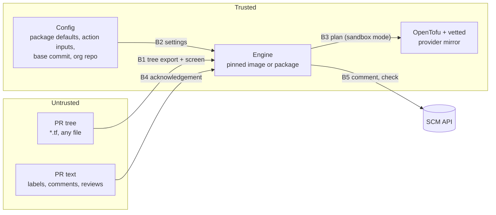

# Threat model — the PR gate

Scope: `emissiongate gate` running in an infrastructure repository's CI on pull requests (ADR-0015,
ADR-0018). The sweep runs on a maintainer's machine or scheduler against the customer's own data and is
covered by E5 and E11. Review this document at every release; a change to a trust boundary needs an
update here in the same pull request.

Status: first version, 25 Oct 2026, written at the start of E1 in
[ENTERPRISE_READINESS.md](ENTERPRISE_READINESS.md). **Not yet independently reviewed.**

## Assets

| Asset | Why it matters |
|---|---|
| Integrity of the check result | A required check that a PR author can turn green defeats the gate. |
| Tokens on the runner | The Actions `GITHUB_TOKEN` can write comments; an App token can do more. |
| The runner | Code execution on it reaches the token, the cache and anything else the job can see. |
| Customer telemetry and billing summaries | Confidential; they also drive observed-utilisation figures. |
| Evidence (ledger, prediction, comment) | The audit trail of what was decided and who accepted an increase. |

## Actors

| Actor | Can |
|---|---|
| PR author with write access | push commits and branches, edit any file in the PR tree, set commit metadata (author and committer dates), add labels, review others' PRs |
| Fork contributor | edit any file in the PR tree; no secrets, read-only token on `pull_request` |
| Reviewer / maintainer | review, label, approve, merge; edit policy through reviewed PRs |
| Compromised dependency | run code inside the engine process or OpenTofu (Python package, provider binary, action) |

## Trust boundaries

## Threats and controls (STRIDE per boundary)

Status: **built** (control and test exist), **E1** (in this phase), **later** (named phase), **open**.

### B1 — PR tree → engine

| Threat | STRIDE | Control | Status |
|---|---|---|---|
| `git archive` honours the PR's own `.gitattributes` (`export-ignore`, `export-subst`), so the planned tree differs from the commit | T | Export from tree objects with `git ls-tree` + `git cat-file --batch`; check the exported file list equals the tree | built (`tests/security/test_tree_export.py`) |
| Symlink in the tree points outside the checkout (`/proc/self/environ`, `~/.ssh`) and is read at plan time | I | Symlinks and submodules are never exported; their presence makes the PR "not evaluated" | built |
| HCL the screen does not read (`*.tf.json`, `*.tofu`, files in local module directories) carries a data source or provider | E, I | Screen every file OpenTofu loads, recursively; refuse unscreenable formats until the parser lands | built, interim (`test_screen.py`); parser-based allowlist later in E1 |
| File functions read outside the configuration (`file("../../x")`, `~`, absolute paths), or through a path the screen cannot see (`file(var.p)` with a default or an auto-loaded `*.tfvars` value of `/proc/<ppid>/environ`) | I | File-family calls accept only a literal relative path, optionally `${path.module}/`-prefixed; `pathexpand` and `abspath` refused; sandbox gives tofu read-only inputs only | built, interim (`test_screen.py`); sandbox E1 |
| Plan-time network calls (data sources, `http`, remote modules, custom endpoints, backends) | I, E | Static screen refuses them; only the AWS provider exists in the mirror; no credentials in tofu's environment | built (`test_safety.py`) |

### B2 — configuration → engine

| Threat | STRIDE | Control | Status |
|---|---|---|---|
| PR adds `.env` setting `EG_TOFU_BIN`, `EG_POLICY`, `EG_TOFU_PLUGIN_DIR`, etc.; the engine loads `.env` from its working directory | E, T | CI mode (`--ci`) never reads `.env` files; only the job's environment (set by the workflow) | built (`test_trusted_config.py`) |
| PR adds `policy.yaml` or `suppressions.yaml` at the working directory, raising thresholds | T | CI mode never reads policy from the working directory: action input (`EG_POLICY`), the base commit (`--config-from-base`), or the package default | built |
| PR plants telemetry, prices, a provider mirror or a tofu data directory inside its tree | T, E | CI mode refuses any configured path inside the untrusted checkout | built |
| PR edits the workflow file itself (with `pull_request`, the workflow comes from the PR) | T | Branch ruleset with a required workflow from a protected location, or the org-level required workflow; documented in the reference setup | later (E2 recipe, E7 rulesets) |

### B3 — engine → OpenTofu (sandbox mode)

| Threat | STRIDE | Control | Status |
|---|---|---|---|
| Provider or tofu bug exploited by crafted HCL | E | Vetted mirror only; plan-only subcommands; no credentials in env | built |
| Tofu reads secrets from the environment | I | Environment denylist of token, key and cloud-credential names | built; allowlist E1 |
| Tofu reaches the network or writes outside its workspace | I, T | No-network sandbox, unprivileged user, read-only inputs, data dirs outside the checkout | E1 (sandboxed planning) |
| Plan-JSON mode removes plan execution entirely | — | The customer's plan job runs the plan; the engine reads JSON with a size limit and `format_version` check | later (E2) |

### B4 — PR text → acknowledgement

| Threat | STRIDE | Control | Status |
|---|---|---|---|
| Acknowledgement carries over to a later push by backdating the new commit's committer date (the old check compared label time with commit time) | S, T | Bind the acknowledgement to the head SHA: a pull-request review whose `commit_id` equals the head SHA | built (`test_acknowledgement.py`) |
| A user without write access (or a bot) acknowledges | S, E | Reviewer must be a `User` with `write`, `maintain` or `admin` permission, checked server-side | built |
| A bot or triage-role user adds the label and someone's unrelated review completes it | S | The latest label event's actor must be a `User`, and the same person must give the head-commit review | built |
| PR author acknowledges their own increase | R | Separation of duties, on by default for production environments | later (E5) |
| SCM API error while checking | D | Fail closed: no acknowledgement; the check stays failing; the error is ledgered | built |

### B5 — engine → comment and check

| Threat | STRIDE | Control | Status |
|---|---|---|---|
| Untrusted text (addresses, attribute values, tofu errors, reasons) injects Markdown or HTML, `@mentions` or links into the comment | T, S | Escape for Markdown and HTML, neutralise mentions and autolinks, cap length; code spans and fences sized to their content; attribute values validated before display | built (`test_output_escaping.py`) |
| A diff in a suggestion closes its code fence early | T | Fence longer than any backtick run in the diff | built |
| Silent partial coverage reads as "all good" | R | Every comment states resources seen, quantified, not quantified and not carbon-relevant | built |
| Token with more permission than needed | E | Per-job `permissions`; the evaluate job has `contents: read` only; the publish job has `checks: write`, `pull-requests: write` and reads | built (`test_workflows.py`) |
| Plan-time code reads the token from the gate process or its parent | I, E | Two-step gate: evaluate runs with no token at all; publish never runs PR code (`workflow_run`, definition from the default branch) | built (reference workflow, `test_workflows.py`) |
| A PR edits the evaluate workflow (a `pull_request` run uses the PR's own workflow files) and uploads a forged `evaluation.json`, e.g. with no projections | T, E | Publish runs only for `workflow_run.path` = the evaluate workflow, and fails the check closed when the PR changes anything under `.github/` (or more files than it can list) | built (`test_publish.py`, `test_workflows.py`) |
| A second PR with the same head commit (into another branch, or with its own workflow files) writes the latest check run on that commit, which branch protection on the first PR reads | T, E | Every open PR on the commit (`commits/{sha}/pulls`, plus the artefact's PR) must target the trusted default branch and leave `.github/` unchanged; otherwise the check fails closed | built (`test_publish.py`) |
| A forged `evaluation.json` claims an acceptance, targets another PR or commit, or hides a figure as NaN, Infinity or a negative value | T, S, E | Size cap; strict schema; non-finite and negative figures refused; bound to the event's head SHA and repo; PR head confirmed via the API or nothing is published; status re-derived in `core/verdict.py` with the default branch's policy; acceptance never read from the artefact | built (`test_publish.py`) |
| Artefact text (reasons, notes, addresses, run ids, SHAs, parameter keys) injects into the comment, the check summary or the privileged job log | T | Re-rendered from validated data with every string escaped; `energy_label` is one of two words; the artefact's `comment.md` is never read | built |
| Comment spam or flooding | D | One sticky comment, idempotent upsert | built |

## Residual risks and assumptions

- **Token in the parent process (closed in the reference workflow, 19 Nov 2026).** Evaluate holds no
  token, and publish runs no PR code. It stays open for anyone using the single-job `gate --ci --post`,
  which now warns.
- **Numbers from a compromised evaluate job (open, E1 sandboxed planning).** With the workflow files
  unchanged, the evaluate job runs only the engine and the screened plan. Publish re-derives the
  status but has to trust the projections; plan-time code execution in the evaluate job could forge
  them. The screen and the vetted mirror stop the known paths; sandboxed planning is the defence in
  depth.
- **"Not evaluated" (policy, ADR-0022).** The shipped policy fails it. GitHub counts a
  `neutral` check as passing a required check, so a repository that sets
  `gate.not_evaluated_conclusion: neutral` lets a PR that trips the screen, or breaks its plan,
  merge without an acknowledgement. A policy without the key fails.
- **PRs that change `.github/`** always fail the check, including Dependabot action updates. A
  maintainer reviews and merges those on their own (bypass or a separate ruleset).
- **The engine is installed from `ref: main`** in both workflows. A release pin is an E2 item.

- In plan-JSON mode the customer's plan job is trusted. If it plans untrusted PR code with real
  credentials, that risk is theirs and outside EmissionGate's control; the recipes say so.
- Hosted runners report no hardware counters; the gate's own energy is labelled "estimated".
- The independent security review required before 1.0 has not happened yet.
